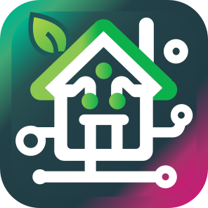

<!-- Commented out section
## [1.0.0] - 2025-07-01

### Added

- [Feature 1]: Description of the feature.
- [Feature 2]: Description of the feature.

### Changed

- [Feature 3]: Description of the change.
- [Feature 4]: Description of the change.

### Deprecated

- [Feature 5]: Description of the deprecation.

### Removed

- [Feature 6]: Description of the removal.

### Fixed

- [Bug 1]: Description of the bug fix.
- [Bug 2]: Description of the bug fix.

### Security

- [Security 1]: Description of the security improvement.

-->

#  &nbsp;&nbsp;&nbsp;Matterbridge Xiaomi Roborock Plugin changelog

All notable changes to this project will be documented in this file.

## [Next] - ??

### Fixed

- **Mop-only clean modes** sent a fan speed of `-1` to the robot (it was only the tables' "off" placeholder, and `0` is a real fan speed on some models): they now only set the water level. While mopping, the current clean mode follows the water level.

### Changed

- **Fan speeds, water levels and cleaning states from node-miio 0.11.0** ([afharo/node-miio#56](https://github.com/afharo/node-miio/pull/56)), shared with homebridge-xiaomi-roborock-vacuum, instead of this plugin's own copy (`src/models/`). A test pins what each model gets. What changes:
  - **S7 and newer** (`a15`, `a51`, `a65`, `a73`, `a75`): fan speed 105 is "Mop" (mop only, no suction), not "Soft". **S7 MaxV** (`a27`) gets it too: its clean modes after it are renumbered (update the automations that use them by number).
  - **S7 Pro Ultra** (`a62`): its own fan speeds (with Mop and Custom) and water levels, instead of the defaults: its clean modes are renumbered too.
  - **Dreame 1C** (`dreame.vacuum.mc1808`): Silent, Standard, Medium and Turbo (same values).

## [v0.11.0] - 2026-11-21

### Added

- **The room the robot is cleaning, without the Xiaomi Cloud**: newer Roborock robots report it in their status (node-miio's `currentSegment`), and it's now the Matter current area. With the `cloud` option, the room still comes from the map.

### Changed

- **node-miio 0.10.0**: the room being cleaned, from the robot's status ([afharo/node-miio#53](https://github.com/afharo/node-miio/pull/53)).

## [v0.10.1] - 2026-11-21

### Fixed

- **The current clean mode didn't follow the water level**: the plugin read the water level as `water_box_mode`, but node-miio's property (and state change) is `waterBoxMode`, so it was always unknown. The Matter current clean mode only matched when the fan speed alone was enough, and didn't change when the water level was changed from the robot's app.
- **The water level of newer Roborock firmwares** (e.g. S7/S8 families): node-miio read only the older response format, so the current water level was unknown ([afharo/node-miio#47](https://github.com/afharo/node-miio/pull/47)).

### Changed

- **node-miio 0.9.1**:
  - The water level and the mop route changes are reported as they happen, not only when polled ([afharo/node-miio#51](https://github.com/afharo/node-miio/pull/51)).
  - The robots with a mop-washing dock report "washing the mop" (states 23, 25 and 26) instead of an unknown state: the Matter operational state shows the dock cleaning the mop ([afharo/node-miio#43](https://github.com/afharo/node-miio/pull/43)).
  - Changing the fan speed or the water level leaves a preset such as SmartPlan, which some robots require ([afharo/node-miio#52](https://github.com/afharo/node-miio/pull/52)).

## [v0.10.0] - 2026-11-20

### Fixed

- **Duplicate state polling after a reconnection**: every reconnection started another polling loop, without stopping the previous one.
- **The plugin stopped reacting to the robot after a single failure**: an error while handling a state change or a robot error (e.g. a failed attribute update) ended the stream, so no later change was handled, and RxJS rethrew it as an uncaught exception. Each failure is now logged and handled on its own.
- **Error reasons**: the robot's errors were always reported as "unable to complete operation", with no details. node-miio emits them as `{ id, description }`, not `{ code, message }`. Clearing the error when the robot recovers also needs [afharo/node-miio#39](https://github.com/afharo/node-miio/pull/39).

### Changed

- **node-miio 0.7.0**: the robots share a single list of the Xiaomi account's devices ([afharo/node-miio#41](https://github.com/afharo/node-miio/pull/41)).
- **node-miio 0.5.0**: the robot's errors are now cleared when it recovers ([afharo/node-miio#39](https://github.com/afharo/node-miio/pull/39)). The plugin now uses node-miio's own TypeScript types, instead of hand-written ones that had drifted from the library ([afharo/node-miio#38](https://github.com/afharo/node-miio/pull/38)).

### Added

- **The room the robot is cleaning** (opt-in, Roborock only): with the new `cloud` option, the plugin downloads the robot's map from the Xiaomi Cloud while it cleans, and reports the room it's in as the Matter current area. It needs a one-off `npx node-miio cloud login --qr`; your password is never stored. Before, the current area was only a guess (the first selected room).

- **Configure a robot by its device ID (`did`)**, instead of its IP and token, with the `cloud` option: they're read from your Xiaomi account. When the robot stops answering, the plugin looks for it again in the account, so a new IP (or a new token, after resetting its Wi-Fi) doesn't break it anymore. Robots configured with an IP and token benefit too, when the `cloud` option is enabled.

- **No more token extraction**: with the `cloud` option, a robot configured with only its `ip` gets its token from your Xiaomi account when the plugin starts. The token is now optional in the config.

- **node-miio's debug logs in the plugin's logs**: with the `debug` option enabled, the logs include what the vacuum is sent and answers (tokens and passwords redacted), with no need for the `DEBUG` environment variable (requires node-miio ≥ 0.5.0, [afharo/node-miio#37](https://github.com/afharo/node-miio/pull/37)).

## [v0.9.0] - 2026-11-19

### Added

- **Error reasons**: the robot's errors are reported with a specific Matter error state (stuck, wheels or brush jammed, dust bin missing or full, water tank empty or missing, mop pad missing, low battery, sensor obscured, no-go zone…) and the robot's message as details, so controllers can tell _why_ it stopped. The error is cleared when the robot recovers.
- **Dock and maintenance states**: emptying the dust bin, washing or drying the mop, filling the water tank and building a map are reported with their own operational states (Matter RVC Operational State revision 4).
- **Skip area**: skipping a room while cleaning rooms carries on with the remaining ones (or sends the robot home if it was the last one).
- **Operation completion**: cleaning sessions started outside Matter (Mi Home app, schedules, the robot's buttons) now emit the "operation completed" event too, so automations work for every run.
- **Multi-floor maps**: when the robot has more than one saved map, the maps are exposed and the rooms are assigned to the current one. Only the rooms of the current map are listed: the robot doesn't report the other floors' rooms ([#212](https://github.com/afharo/matterbridge-xiaomi-roborock/issues/212)).
- **Vacuum & mop presets** ([#162](https://github.com/afharo/matterbridge-xiaomi-roborock/issues/162)): robots with a water box get 3 presets that vacuum and mop at the same time, like native Matter vacuums. **Automatic** (balanced fan + medium water), **Deep clean** (max fan + high water) and **Quiet** (quiet fan + low water) are listed first. The existing vacuum-only and mop-only modes are kept, with the same mode numbers.
- **Cleaning types on MIoT vacuums** (requires node-miio ≥ 0.3.0): a **Vacuum then mop** clean mode on the models that support it, and the presets above switch the robot to vacuum & mop. The vacuum and mop modes also switch it to vacuum-only or mop-only.

### Fixed

- **An offline vacuum no longer blocks Matterbridge** ([#248](https://github.com/afharo/matterbridge-xiaomi-roborock/issues/248)). The device info (model, firmware, serial, clean modes, rooms) is now saved after each connection. If the vacuum isn't reachable on startup, it's registered from the saved info after 15s, and its state updates once it's back online. If it was never connected before, it's skipped after 60s, so the other devices and plugins can still start. A vacuum that fails to initialize no longer puts the plugin in error state.

### Changed

- Requires Matterbridge 3.10.12 or later (needed by the Skip Area support).

## [v0.8.0] - 2026-11-19

### Added

- Support for **any MIoT vacuum** (Xiaomi, Dreame, Mijia, ijai, newer Viomi like the S9/V13…) via [node-miio 0.3.0-beta.4](https://github.com/afharo/node-miio), which drives the device from its spec on [miot-spec.org](https://home.miot-spec.com). The specs are cached, and a snapshot is bundled for offline setups (related: [#365](https://github.com/afharo/matterbridge-xiaomi-roborock/issues/365), [#242](https://github.com/afharo/matterbridge-xiaomi-roborock/issues/242), [#240](https://github.com/afharo/matterbridge-xiaomi-roborock/issues/240), [#246](https://github.com/afharo/matterbridge-xiaomi-roborock/issues/246), [#83](https://github.com/afharo/matterbridge-xiaomi-roborock/issues/83)).
- Clean modes (fan speeds / water levels) of models not listed in the plugin are now reported by node-miio, instead of defaulting to the Roborock values.

### Changed

- Requires Node.js 22.13+, 24 or 26 (Node.js 20 is EOL).
- Devices that can't turn off the vacuum or the water (e.g. MIoT models) no longer receive those (invalid) levels when switching between vacuum and mop clean modes.
- The project is looking for a new maintainer: see [#387](https://github.com/afharo/matterbridge-xiaomi-roborock/issues/387).

## [v0.7.1] - 2026-09-11

### Fixed

- Resolves Matter transaction deadlock on `goHome` command by removing redundant `await updateAttribute` call within the command handler, which blocked Matter interaction transactions (fixes [#273](https://github.com/afharo/matterbridge-xiaomi-roborock/issues/273)).
- Implements `RvcRunMode.changeToMode` Idle mode (mode 1) to send the vacuum back to the dock rather than an empty `break`.
- Fixes `in_returning` state handler unintentionally overriding paused status when the vacuum is paused while returning to the dock.
- Adds support for `'disable'` status in timer definitions for room cleaning discovery on Roborock models.

## [v0.7.0] - 2026-09-08

- [Fix recent breaking changes from matterbridge](https://github.com/afharo/matterbridge-xiaomi-roborock/pull/352)

## [v0.6.1] - 2026-05-22

### Fixed

- [Error that impeded selecting rooms](https://github.com/afharo/matterbridge-xiaomi-roborock/pull/274).

## [v0.6.0] - 2026-03-12

### Fixed

- [Assign the first room when cleaning rooms](https://github.com/afharo/matterbridge-xiaomi-roborock/pull/251): As highlighted in [#98](https://github.com/afharo/matterbridge-xiaomi-roborock/issues/98), while in room cleaning mode, the vacuum stays in the state "Traveling". Now the plugin will assign the first room to the vacuum. This is hack until a proper solution is found to retrieve the map (which requires a connection to the Xiaomi Cloud servers).

## [0.5.0] - 2025-10-16

### Added

- [Support for Dreame](https://github.com/afharo/matterbridge-xiaomi-roborock/pull/102): As requested in [#83](https://github.com/afharo/matterbridge-xiaomi-roborock/issues/83), there's an initial support for Dreame vacuums.

### Changed

- [Simplified CI and dependencies](https://github.com/afharo/matterbridge-xiaomi-roborock/pull/195): Removing some unnecessary dependencies coming from the original template and simplifying the CI to install matterbridge globally before linking instead of git-cloning and building it.

### Fixed

- [Compatibility with `matterbridge`'s new architecture coming in v3.3.0](https://github.com/afharo/matterbridge-xiaomi-roborock/issues/184).

## [0.4.0] - 2025-08-25

### Changed

- [Battery reports `IsAtFullCharge` when fully charged](https://github.com/afharo/matterbridge-xiaomi-roborock/pull/88): Follow up to the previous version's change. But mostly for consistency and completeness (since iOS makes no visual distinction between `IsAtFullCharge` and `IsNotCharging`).
- [Remove Current Room information](https://github.com/afharo/matterbridge-xiaomi-roborock/pull/94): Retrieving the current room is not available yet. Always reporting the first room (even when not cleaning it) is not a great experience. I think that it's better to not report it at all.
- [Allow using `roomNames` to override the room names retrieved from the vacuum](https://github.com/afharo/matterbridge-xiaomi-roborock/pull/95): Some RVCs return long numeric names to the rooms instead of the actual names configured in the app. This change allows overriding those retrieved names via the existing `roomNames` setting.

### Fixed

- [Check `paused` state when handling `in_cleaning`](https://github.com/afharo/matterbridge-xiaomi-roborock/pull/96): To avoid flipping between `paused` and `cleaning` states, the plugin now checks the `paused` state when handling `in_cleaning`.

## [0.3.0] - 2025-08-22

### Changed

- [Report `ready` when fully charged](https://github.com/afharo/matterbridge-xiaomi-roborock/pull/86): When the vacuum is fully charged, it will report `ready` instead of `charging`.

## [0.2.3] - 2025-08-21

### Fixed

- [Emit changes in properties](https://github.com/afharo/matterbridge-xiaomi-roborock/pull/84): The plugin now emits changes in the properties of the vacuum. This means that many handlers that were not running before will run now.

## [0.2.2] - 2025-08-21

### Added

- [React to `in_returning` state](https://github.com/afharo/matterbridge-xiaomi-roborock/pull/80): This should make the plugin aware of when the vacuum is returning to its dock.

## [0.2.1] - 2025-08-21

### Fixed

- [Room cleaning](https://github.com/afharo/matterbridge-xiaomi-roborock/pull/72): It returned _Method `app_segment_clean` is not supported_. The reason was the format of the parameters (Room IDs must be numbers, not strings).

## [0.2.0] - 2025-08-21

### Fixed

- [Clean modes support](https://github.com/afharo/matterbridge-xiaomi-roborock/issues/68): It now handles the cleaning mode changes.

## [0.1.2] - 2025-08-19

### Fixed

- [`locationName` must be a string](https://github.com/afharo/matterbridge-xiaomi-roborock/issues/64): Makes sure to stringify the room name in case the RV returns a number.

## [0.1.1] - 2025-08-18

### Fixed

- [Errors when no rooms]: Handle the situation when no rooms are found.

## [0.1.0] - 2025-08-18

### Added

Initial release including basic full cleaning support ported from [homebridge-xiaomi-roborock-vacuum](https://github.com/homebridge-xiaomi-roborock-vacuum/homebridge-xiaomi-roborock-vacuum/).
