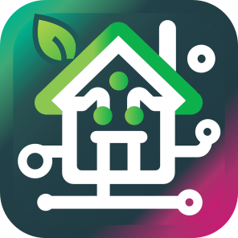

<!-- prettier-ignore -->
> [!NOTE]
> **Beta testers wanted**
>
> The maintainer doesn't own any of the supported models, so changes are developed against automated tests and validated by users on beta releases.
> If you'd like to help, [sign up as a beta tester](https://github.com/afharo/matterbridge-xiaomi-roborock/issues/387): you'll be mentioned when a beta needs a device like yours.
> See [CONTRIBUTING.md](./CONTRIBUTING.md) for other ways to help. Co-maintainers are welcome too.

<p align="center">
    
    
</p>

<h1 align="center">Matterbridge Xiaomi Roborock Plugin</h1>

<p align="center">
    <a href="https://www.npmjs.com/package/matterbridge-xiaomi-roborock">
        
    </a>
    <a href="https://www.npmjs.com/package/matterbridge-xiaomi-roborock">
        
    </a>
    <a href="https://github.com/afharo/matterbridge-xiaomi-roborock/actions/workflows/build-matterbridge-plugin.yml">
           
    </a>
    <a href="https://github.com/afharo/matterbridge-xiaomi-roborock/actions/workflows/codeql.yml">
          
    </a>
    <a href="https://codecov.io/gh/afharo/matterbridge-xiaomi-roborock">
        
    </a>
</p>

<p align="center">
    <a href="https://www.npmjs.com/package/matterbridge">
        
    </a>
    <a href="https://www.npmjs.com/package/node-miio">
        
    </a>
    <a href="https://www.npmjs.com/package/rxjs">
        
    </a>
    <a href="https://www.npmjs.com/package/semver">
        
    </a>
</p>

---

**Matterbridge Xiaomi Roborock Plugin** is a dynamic platform plugin
for [Matterbridge](https://www.npmjs.com/package/matterbridge) that integrates with Roborock vacuum cleaners
**controlled via the Xiaomi Home app**, enabling control via Apple Home and other Matter-compatible apps. If you use the
Roborock app, refer to
the [Matterbridge Roborock Platform Plugin](https://www.npmjs.com/package/matterbridge-roborock-vacuum-plugin) instead.

> ⭐️ If you like this project and find it useful, please consider giving it a star on GitHub
> at [Matterbridge Xiaomi Roborock Plugin](https://github.com/afharo/matterbridge-xiaomi-roborock).

> ⚠️ **Disclaimer**
>
> This project is in a very early stage of development. I'm initially building it to integrate with my Roborock S5, and
> will be extending the support once the basic features are implemented.
>
> Other models might work at this stage, but I cannot guarantee that (mostly because I haven't been able to test them).
> Any help testing other models is welcome. If you find a model that works, please open an issue or a PR to add it to
> the
> list of [supported models](#supported-models).

<!-- TOC -->

- [Features](#features)
  - [Room cleaning and discovery](#room-cleaning-and-discovery)
  - [Current room (Xiaomi Cloud, optional)](#current-room-xiaomi-cloud-optional)
  - [TODO](#todo)
- [Supported models](#supported-models)
- [Known issues](#known-issues)
- [Installation](#installation)
  - [Prerequisites](#prerequisites)
  - [Add the plugin to Matterbridge and your devices to Apple Home (or any other Matter-compatible app)](#add-the-plugin-to-matterbridge-and-your-devices-to-apple-home-or-any-other-matter-compatible-app)

<!-- TOC -->

## Features

- Basic RVC operations (start/stop/pause/resume/go back to dock)
- Fan speed control
- Water level control (only in supported models)
- Room cleaning and discovery (only in supported models)
- The room the robot is cleaning (Roborock, with the optional Xiaomi Cloud access)
- Battery information

### Room cleaning and discovery

The plugin uses 2 methods to discover the rooms defined in the Xiaomi Home app, depending on the features supported by
the model (and shown in the Xiaomi Home app):

1. For supported models where the app allows to add names in the rooms, it is capable of retrieving the names from the
   app.
   - In some cases, the names configured in the app are not returned by this API (instead, it shows a long numeric value). In this case, you can use the `roomNames` configuration option to manually define the names.
2. For other models, it needs a workaround:
   1. In the Xiaomi Home app, while in the vacuum view, open the options by clicking on the 3 dots in the top right
      corner.
   2. Then, in "Timer", define a cleaning timer for midnight (00:00) that repeats every day. Make sure to select all the rooms individually.
   3. Make sure to disable the timer (nobody wants to kick off a cleaning at midnight every day 🙈).
   4. Finally, set up the `roomNames` in this plugin's configuration. Make sure to follow the same order as you
      selected the rooms in the app.

> ‼️ If you need to rely on the 2nd approach, chances are that the vacuum does not support the command to run room
> cleaning (`app_segment_clean`).
> If you find the command that works for these models (testing via `node-miio` or `python-miio`), please open an issue
> or a PR to add this support.

### Current room (Xiaomi Cloud, optional)

The robot doesn't tell which room it's in over the local network: only its map knows, and the map is in the Xiaomi
Cloud. With the `cloud` option, the plugin downloads the map while the robot cleans (every 10 seconds), and reports
the room it's in as Matter's **current area**. It only works with Roborock vacuums, for now.

1. Log in to your Xiaomi account once, **as the same user that runs Matterbridge**:

   ```sh
   npx node-miio cloud login --qr   # scan the QR code with the Mi Home app
   ```

   The session is saved in [node-miio's config directory](https://github.com/afharo/node-miio/blob/main/docs/cloud.md)
   (your password is never stored). If Matterbridge runs as another user or in Docker, copy that file where
   Matterbridge can read it, and set its path in `cloud.sessionFile`.

2. Enable it in the plugin's config:

   ```json
   "cloud": { "enabled": true }
   ```

   Optionally, set `cloud.server` (`de`, `us`, `cn`…) to skip looking for the robot in every server.

With the `cloud` option, the robots' `token` is optional too: a robot configured with only its `ip` gets its token from
your Xiaomi account when the plugin starts. The IP must be the one the Mi Home app shows.

Even simpler, configure the robot with its device ID (`did`) instead of its IP and token:

```json
{ "name": "Robot", "did": "123456789" }
```

The plugin reads the IP and token from your Xiaomi account, and **finds the robot again if they change**: when the
robot stops answering (a new IP from the router, or a new token after resetting its Wi-Fi), the plugin asks the Xiaomi
account where it is now, and reconnects. The `did` is in the logs (`Xiaomi Cloud: found "Robot" (did 123456789) at …`)
and in `npx node-miio cloud devices`. A fixed IP for the robot in your router is still the most reliable setup: the
Xiaomi account only knows the new IP once the robot reports it.

If the session expires, the plugin logs a warning: log in again and restart the plugin.

### TODO

- [ ] Improve state control
- [ ] Additional controls like initiate dust collection are missing
- [ ] Add information about the Maintenance counters (sensors, filter, brush)
- [ ] Add better error handling (expose the errors to the user if possible)

---

## Supported models

| Model            | Code name             | Basic info (battery, serial, firmware) | Full cleaning | Room cleaning |  Tested by  |
| ---------------- | --------------------- | :------------------------------------: | :-----------: | :-----------: | :---------: |
| Roborock S5      | `roborock.vacuum.s5`  |                   ✅                   |      ✅       |      ✅       |   @afharo   |
| Roborock S6 MaxV | `roborock.vacuum.a10` |                   ✅                   |      ✅       |      ✅       | @alexh-name |

## Known issues

| Issue                                                             | Comment                                                                                 | Workaround                                  |
| ----------------------------------------------------------------- | --------------------------------------------------------------------------------------- | ------------------------------------------- |
| The name of the device is not automatically placed in Apple Home. | AFAIK, this happens to all Matterbridge devices (all show as `Matterbridge Accessory`). | The device must be renamed in the Home App. |

## Installation

This plugin leverages the Matterbridge ecosystem, so you can install it in the same way as any other Matterbridge
plugin.

> ℹ️ This is not a Homebridge plugin. You need to install Matterbridge instead.

### Prerequisites

You need to have [Matterbridge](https://github.com/Luligu/matterbridge) installed. Refer to their [installation guide](https://github.com/Luligu/matterbridge?tab=readme-ov-file#prerequisites) for more details.

Additionally, you need the IP and token of the RVC. The easiest way is to let the plugin read the token from your Xiaomi account: enable the [Xiaomi Cloud](#current-room-xiaomi-cloud-optional) and configure only the robot's `ip`, or its `did`. You can also print the tokens of all your devices with node-miio:

```sh
npx node-miio cloud login --qr   # scan the QR code with the Mi Home app
npx node-miio cloud devices      # name, model, IP and token of each device
```

> ⚠️ If the RVC's Wi-Fi connection is reconfigured, a new token is generated, and you will need to retrieve it again, and update this plugin's configuration (unless the plugin reads it from the Xiaomi Cloud).
>
> The same happens if the RVC is paired/controlled via the Roborock app.
>
> If you already use [homebridge-xiaomi-roborock-vacuum](https://github.com/homebridge-xiaomi-roborock-vacuum/homebridge-xiaomi-roborock-vacuum), the same IP and token can be used.

### Add the plugin to Matterbridge and your devices to Apple Home (or any other Matter-compatible app)

Once on the Matterbridge UI, install this plugin using the name `matterbridge-xiaomi-roborock`, and configure it. After restarting Matterbridge, a new device should appear in the list of Devices in the Matterbridge UI, scan the QR code with the Apple Home app (or any other Matter-compatible app), and you should be good to go!
